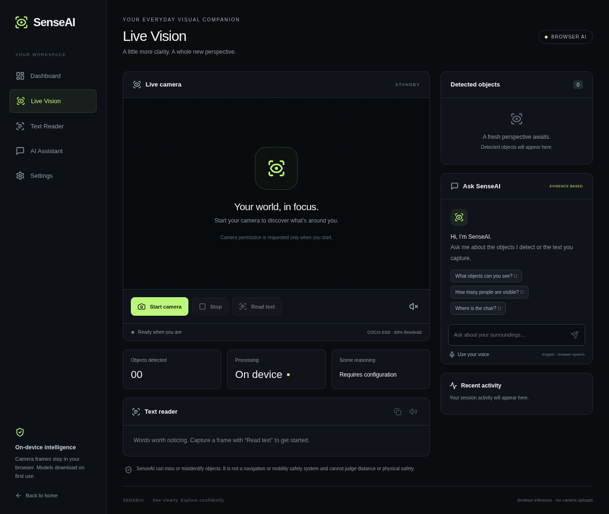
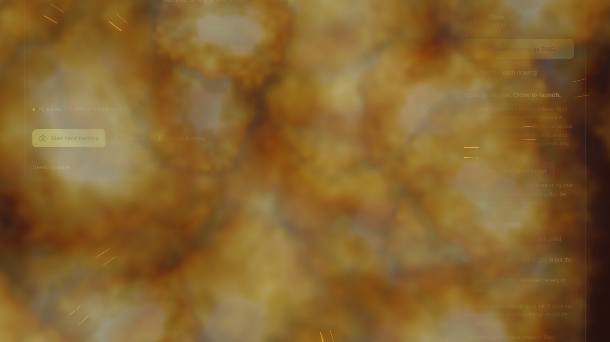

# SenseAI

A browser-based visual assistant built with Next.js, TypeScript, TensorFlow.js COCO-SSD, Tesseract.js, and Web Speech APIs.

## Run locally

Use Node.js 22 or 24. Clone this repository, run `npm ci`, then `npm run dev`. Open localhost:3000 and launch the studio. A webcam is optional until you choose Start camera. Production requires HTTPS for camera and microphone permissions.

## Features

- Real webcam capture and COCO-SSD object detection with confidence and bounding boxes.
- English OCR from captured camera frames; copy and speech output.
- Typed questions about detections, counts, positions, and captured text.
- Browser speech recognition where supported; opt-in spoken answers.
- Responsive dark interface, high contrast and larger-text settings.

Models and OCR language assets download on first use. No camera frames are uploaded by this application. Browser speech recognition may send audio to the browser vendor. COCO-SSD recognizes its pretrained object classes only and can miss objects. Full vision-language reasoning is **not configured**; no API key is required for the browser features. SenseAI cannot estimate distance or judge safety and is not a navigation system.

## Air writing

Open **Air Writing** from the studio or **Try air writing** on the landing page. Start hand tracking, keep one hand well lit, and pinch thumb/index together while moving your index fingertip to draw. Release your pinch between strokes. Pause, undo, clear, change pen color/width, or save a PNG containing only your writing. Mouse/touch mode is an optional fallback. This draws ink; it does not convert handwriting to typed text. The first use downloads MediaPipe WASM from cdn.jsdelivr.net and its hand model from storage.googleapis.com.

Open your hand briefly to charge a particle flame, then close all four fingers into a fist to launch a fireball across the camera view. It leaves an ember trail, then expands across the entire browser viewport with textured fire clouds, cooling smoke, radial sparks and a shockwave. Escape dismisses the effect immediately. Pinching still draws. **Preview full-screen burst** plays the actual animation without a camera; it does not simulate hand recognition. Reduced-motion settings soften the effect, and exports contain only your writing.

Drawing quality includes quadratic curves, speed-adaptive stabilization, undo/redo, camera visibility controls and a focus view. PNG exports default to 1920×1080. Camera startup requests up to 1080p/30fps; the displayed dimensions show what your device actually supplies. The camera preview and export aspect ratio adapt to its actual dimensions.

## Checks

`npm test`, `npm run typecheck`, `npm run lint`, `npm run build`. `npm start` serves the production build. Seventeen unit tests cover evidence-based responses and localization. Fifteen Chromium tests cover UI, generated-media camera lifecycle, permission errors, real OCR, and speech controls/fallbacks. Run `npm run test:browser` while a production server is running; install a browser first with `npx playwright install chromium` if system Chromium is unavailable. See PROJECT_STATUS.md for exact evidence and unverified hardware/model checks.

## Deployment

Import `Daniverse-dev7/senseai` into Vercel, select Next.js, and deploy the `work` branch (or merge it into your production branch). Build: `npm run build`; install: `npm ci`. No environment variables required. HTTPS is supplied by Vercel. Model access requires storage.googleapis.com; OCR uses cdn.jsdelivr.net. Verify camera permission and model/OCR downloads on the actual deployment before announcing launch. No public deployment URL has yet been verified.

## Resume from another computer

Clone `https://github.com/Daniverse-dev7/senseai.git`, fetch branches, check out `work`, and read AGENTS.md, PROJECT_STATUS.md, DEVELOPMENT_LOG.md and NEXT_STEPS.md. Run `git pull --ff-only`, `npm ci`, and the checks above. Never store secrets in Git.

### Energy, portals and video clips

Open `/air-writing` and choose an interaction:

- **Two-hand energy:** show both open palms, separate them to grow the plasma sphere, then push both toward the camera to release. Keep both hands visible; release uses their apparent size in the camera image.
- **Portal drawing:** pinch and draw one closed, round circle, then release. A recognized circle becomes a swirling portal for seven seconds. Unrecognized strokes remain ink. Mouse/touch drawing works too.
- **Record your scene:** start recording, perform gestures or play an animation preview, then stop and download the clip. The video includes the active mirrored camera, writing and effects, with full-screen bursts fitted inside the frame. Clips are silent, at most 30 seconds, up to 1280 pixels wide within a 720p pixel budget. WebM or MP4 depends on browser support. Nothing is uploaded; download before leaving the page. Hiding the tab ends recording. PNG export still contains ink only.

Each interaction has a camera-free preview. Escape clears effects; reduced-motion settings soften animations. Physical hand tracking must still be checked on a real webcam; cloud tests cover gesture geometry, pointer input, rendered animation and real browser video encoding.
